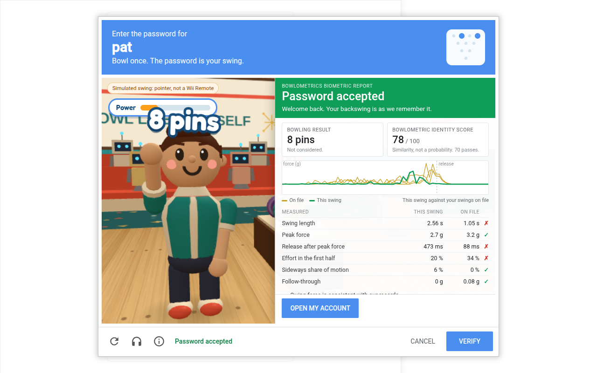
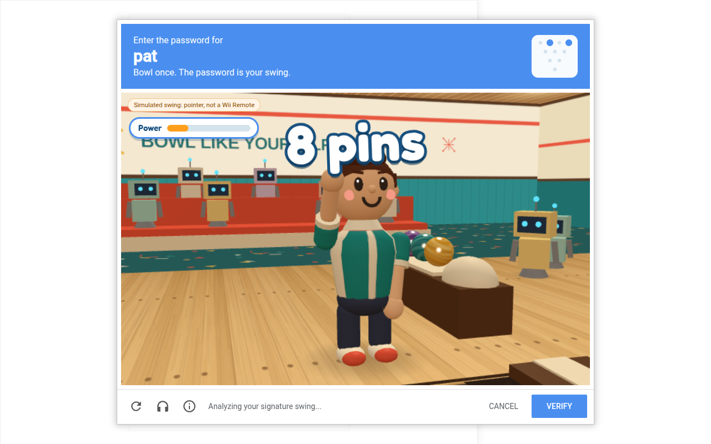

<div align="center">

# Bowlometrics

#### Stupidest Metric | A login with no password field: your password is how you bowl

Type a username, pick up a Wii remote and bowl. The site checks your swing and ignores your pins.<br>
A gutter ball from the right arm gets in. A strike from a stranger is turned away.

**[Live demo](https://bowlometrics.pages.dev)** &nbsp;·&nbsp; [Setup](docs/setup.md) &nbsp;·&nbsp; [How it works](#how-it-works) &nbsp;·&nbsp; [Submission notes](docs/submission.md)

[](LICENSE)

</div>



Made for the Stupid Ideas Hackathon (Ottawa F26). It is a joke. It is not security, and there is no real money in the bank behind it.

## The problem

Passwords get guessed, reused and forgotten. Fingerprints and face scans fixed that years ago, and they work, which makes them no use at a stupid ideas hackathon.

Nobody has ever had their backswing stolen. So we took the password field off the login page and replaced it with the least convenient thing we could find that is still about you: one full bowling throw with a Wii remote, standing up, wrist strap on.

## What it does

- **No password field:** the front page has a username box and two buttons.
- **Bowl to create an account:** a CAPTCHA-style window opens with a whole bowling game in it. Three throws go on file as your password.
- **Bowl to log in:** type your username and bowl once. The swing is checked against that account, and the answer is accepted, bowl again or declined.
- **The pins decide nothing:** the report shows your bowling result with the words "Not considered" under it.
- **A biometric report:** after every bowl, the measured numbers sit beside the ones on file, with a graph of the force through the swing.
- **It tells on people:** a declined attempt is kept on the owner's account. If the swing fits another customer, the owner is told who it was.
- **Real Wii remote:** the accelerometer is the password. The sensor bar or the D-pad aims, a tilted remote sends the ball sideways, and a wrist twist makes it curve.
- **Works with no hardware:** on the public site your pointer stands in for the remote, and the page labels it as simulated. Two sample customers are there to watch.
- **A crowd with opinions:** an announcer calls each throw and verdict, and two robots in the stands react with speech bubbles.



## Tracks

| Track | What we built for it | Where it lives |
|---|---|---|
| General | A login page where the sensible part, the password, is replaced by a bowling throw inside a fake CAPTCHA | [Live demo](https://bowlometrics.pages.dev), [`web/src/main.js`](web/src/main.js) |
| Stupidest Metric (Amplitude) | The **Bowlometric Identity Score**: 0 to 100 for how much you bowl like yourself. 70 passes. Around it: attempts on your account, you-ness over time, a ranking of who is most and least themselves, gutter balls let in and strikes turned away. Each log-in bowl is sent to Amplitude as a `signin_attempt` event | [`web/src/motion/matcher.js`](web/src/motion/matcher.js), [`web/src/analytics.js`](web/src/analytics.js) |

Events carry scores and counts. They never carry usernames, account numbers or swing data.

## How it works

```
Wii remote → Bluetooth → Linux hid-wiimote driver → bridge (Node) → WebSocket → browser → swing matcher
```

1. The remote's three-axis accelerometer is read at about 100 Hz, from 250 ms before B is pressed to 400 ms after it is let go.
2. The swing becomes a signature: 64 points per axis with the release always at the same point, plus timing features such as how long it took, how hard it peaked and how much the arm kept moving afterwards.
3. Two signatures are compared with dynamic time warping plus the feature differences. That gives one distance.
4. Three enrollment throws make a profile. Its pass mark comes from how much those three throws differ from each other.
5. A log-in swing is scored against the profile for the typed username. A declined swing is then compared with everyone else on file, and named if it fits.
6. Pin count, ball speed and aim are worked out in a separate file, [`web/src/game/throw.js`](web/src/game/throw.js), and never reach the matcher.

**The hard part** was not the matching. The laptop's kernel refused to start the Wii remote driver, because the driver asks for one unbroken 1 MB block of memory and a laptop that has been on for days has none. [`scripts/fix-driver.sh`](scripts/fix-driver.sh) makes the kernel tidy its memory and restarts the remote's input link, with no sudo and no button press. A bowling ball cannot be thrown until it has run.

## Built with

| Layer | Stack |
|---|---|
| 3D hall, bowler and robots | [Three.js](https://threejs.org/) |
| Dev server & build | [Vite](https://vite.dev/) |
| Remote to browser | [ws](https://github.com/websockets/ws) and the Linux [hid-wiimote](https://docs.kernel.org/hid/index.html) driver |
| The metric | [Amplitude](https://amplitude.com/) browser SDK |
| Voices, crowd and music | [ElevenLabs](https://elevenlabs.io/), filtered with [FFmpeg](https://ffmpeg.org/) |
| Hosting | [Cloudflare Pages](https://pages.cloudflare.com/) |

Off the shelf: the 3D library, the build tool, the WebSocket library, the analytics SDK, the font, and the generated voice and music clips. Written by us: the swing signature and matcher, the pin physics, the bridge that reads the remote from the kernel's input devices, the bowler and robots (built in code from simple shapes), the login window and the report.

## Try it

```bash
git clone https://github.com/thomasnol/proof-of-human.git
cd proof-of-human && npm install && npm run dev
```

Then open http://localhost:5173/ and bowl with your mouse. The Wii remote, the controls and the tests are in [`docs/setup.md`](docs/setup.md).

## What's next

- Measure the matcher on real people. Its pass marks were set on swings made by a formula, and `npm run evaluate` is ready for real recordings.
- Try a MotionPlus. The code reads its turning rates, but no MotionPlus was attached during the build.
- Let a judge's own laptop use the remote. Today the remote only works on the laptop that runs the bridge.
- Keep accounts somewhere other than one browser's storage.

## Team

- **Jowi Aoun** ([@JowiAoun](https://github.com/JowiAoun)): the Wii remote bridge and scripts, the swing matcher, the pin physics, tilt and spin, the voices and music.
- **Ishar** ([@isharghura](https://github.com/isharghura)): the username login and its CAPTCHA window, the report and the attempts log, the bowler, the robots and the retro hall.
- **Thomas** ([@thomasnol](https://github.com/thomasnol)): the first plan and the first playable prototype.

## License

[MIT](LICENSE)
