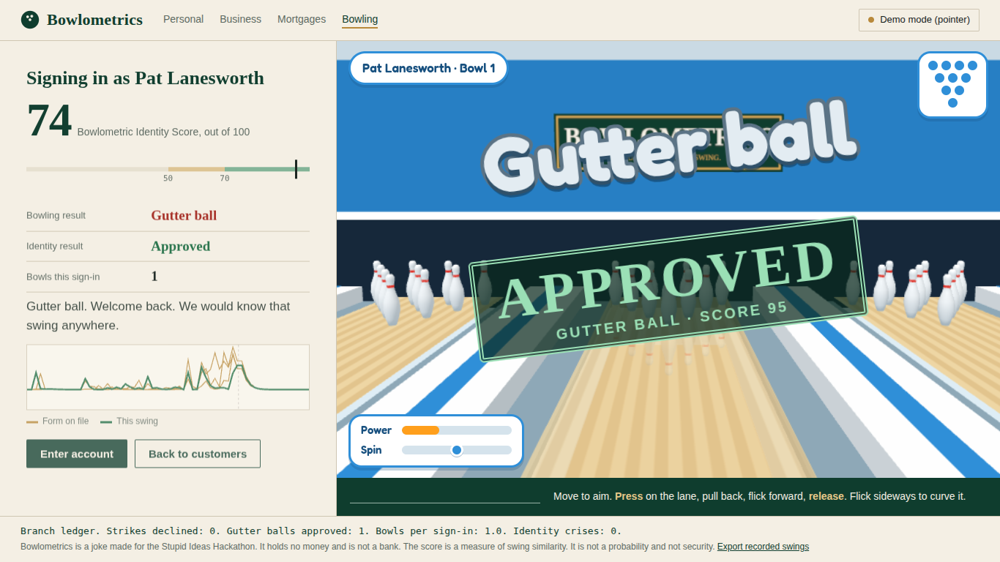

# Bowl ID

A username, and no password. Your password is how you bowl. 🎳

The page has a username field and no password field. Type a username and press "Create this account". A familiar CAPTCHA-style window opens with a whole bowling game inside it. You pick up the Wii remote and bowl three times, and the site keeps your swing on file as your password. To come back, type your username, press "Log in with your swing" and bowl once. The swing is checked against that one account.

Type somebody else's username and bowl, and you are turned away. The owner is told how many times that has happened. If the swing fits another customer on file, the owner is told who it was.

The pins decide nothing. A gutter ball from the right arm gets in. A strike from a stranger is turned away.

Made for the Stupid Ideas Hackathon (Ottawa F26). Tracks: General, Stupidest Metric. This is a joke, not security, and there is no real money in the bank behind it.

Try it in your browser: https://bowlometrics.pages.dev

## The metric

**The Bowlometric Identity Score**: 0 to 100, how close this swing is to the swings on file for the username that was typed. 70 and up passes. It is a similarity measure and not a probability.

Each account keeps its own numbers and shows them to its owner after a log-in:

- **Attempts on your account**: log-ins that typed your username and ended without a matching swing. An attempt whose swing fits another customer is listed with that customer's username. One that fits nobody on file may be a stranger, or the owner on a bad day, and the page says so.
- **You-ness over time**: the owner's scores as a line and the declined attempts as dots, against the pass mark of 70.

The front page ranks everyone who has logged in by their average score as themselves, under "Most and least themselves".

The branch ledger under the front page keeps four more, all counted from real bowls:

- Gutter balls let in.
- Strikes turned away.
- Identity crises: bowls that open the right account and would also open somebody else's.
- Bowls per log-in.

With an Amplitude key set, `signin_attempt`, `account_attempt_declined`, `login_done` and `identity_created` events carry the same numbers (`bowlometric_identity_score`, `verdict`, `fits_another_customer`, `intruder_identified`, `attempts_since_last_visit`, `got_in_on_a_gutter_ball`). Events never carry usernames, account numbers or swing data.

## Run it

Anywhere, with a mouse or a touch screen:

1. Run `npm install`
2. Run `npm run dev`
3. Open http://localhost:5173/

On the Ubuntu demo laptop, with the Wii remote:

1. Run `./scripts/pair-wiimote.sh` and press the red SYNC button under the battery cover.
2. Run `./scripts/start.sh`
3. Open http://localhost:5173/?mode=wii

## Controls

| | Aim | Bowl | Menus |
|---|---|---|---|
| Wii remote | Point at the screen, or D-pad | Hold B, swing back, swing forward, let go of B. A remote tilted to one side at the release sends the ball that way, and a wrist twist makes it curve. | A is "Log in" on the front page and the main button after that. 2 is "Create". HOME cancels. `-` mutes. `1` recentres the aim. |
| Mouse or touch | Move over the lane | Press, pull back, flick forward, let go | Click |
| Keyboard | Left and right arrows | Hold Space, let go when the power bar is high | Esc cancels |

The username is typed on the laptop's keyboard. A pointer swing is a simulation and the app says so on screen. Pointer accounts and Wii accounts are kept apart and never compared. The keyboard can bowl but records no swing, so it cannot create an account or log in.

## How a swing becomes an account

1. **Record.** The remote's three-axis accelerometer is read at about 100 Hz from 250 ms before B is pressed to 400 ms after it is let go. With a MotionPlus attached, three axes of turning rate are recorded too.
2. **Signature.** The swing is resampled to 64 points per axis with the release always at the same point. Timing features are added: how long the swing took, how hard it peaked, how long after the peak the button was released, how much of the effort came early, how the motion splits across axes, and how much the arm kept moving afterwards. With a MotionPlus, the peak turning rate and how the turning splits across axes are added.
3. **Distance.** Two signatures are compared with dynamic time warping over the waveforms plus the feature differences.
4. **Profile.** Three enrollment throws make a profile. Its accept distance comes from how much the three throws differ from each other. A throw that looks nothing like the other two is struck out and replaced.
5. **Check.** A log-in swing is compared with the profile of the username that was typed. There are three answers:
   - **Match** (70 and up): the account opens.
   - **Inconclusive** (50 to 69): bowl again, up to three times.
   - **Mismatch** (below 50): declined.
6. **Who else.** A log-in that ends without a match is recorded as an attempt on that account. The swing is then compared with every other profile recorded with the same kind of input. If it fits one, that customer is named, to the bowler and to the owner. The nearest customer is never named just for being nearest. A swing that opens the typed account and would also open another one is let in and counted as an identity crisis.
7. **Enrollment check.** A new profile that sits on top of an existing customer is sent back once for a more personal swing. If it is still a twin, the account opens and the two accounts share a password.

The report after each bowl shows the measured numbers next to the ones on file, and a graph of the force over the swing. Every row is a real measurement. The remote cannot see a body or an arm, so nothing in the report claims to.

Pin count, ball speed and aim are worked out separately in `web/src/game/throw.js` and never reach the matcher.

## Measure it on real people

The thresholds in `MATCH_CONFIG` (`web/src/motion/matcher.js`) were set on swings made by a formula. They have to be checked on real throws.

1. Each person opens http://localhost:5173/?mode=wii&who=theirname
2. Click "Practice lane" and bowl at least 8 times. The status line also says who the swing would have opened.
3. Click "Export recorded swings" on the front page and move the file into `recordings/`.
4. Run `npm run evaluate`

It enrolls each person on their first three throws and tests the rest. It reports how often a person opens their own account, how often they open somebody else's, how often a stranger gets in, and how often the answer is a crisis or a retry, with sample counts.

Run `npm run evaluate -- --synthetic` to check the tool itself on made-up swings.

## Deploy

1. Run `npx wrangler login` once.
2. Run `npm run deploy`

This publishes `dist/` to Cloudflare Pages as the `bowlometrics` project, at https://bowlometrics.pages.dev. The public site works with a pointer on any laptop. It has two labelled sample customers with formula swings: each can be watched logging in, and one can be watched trying the other's account.

The Wii remote is read by a small program on the Ubuntu laptop, which only listens on that laptop. So the remote works on that laptop and nowhere else: hand a judge the remote and our screen. Accounts live in that browser's storage, so enroll on the laptop and in the browser that will be used on stage.

## How it is built

- `web/src/main.js`: the front page, the challenge window, the report and the account.
- `web/src/id/store.js` and `copy.js`: the accounts kept in the browser, and everything Bowl ID says.
- `web/src/motion/signal.js` and `matcher.js`: the swing signature, the distance, the profiles and the check against a username.
- `web/src/game/`: the hall, the bowler, the robot spectators, the pin physics and the sounds. The sounds are made with Web Audio and there are no sound files.
- `web/src/input/sources.js` and `bridge/`: the Wii remote, the pointer, and the bridge between the remote and the browser.
- `tools/evaluate.mjs`: the measurement described above.

## What was tested

- `npm test`: 53 tests, one of them skipped. The matcher tests use swings made by a formula.
- The username flow in a headless Chrome on a Mac, with formula swings fed through the same path the pointer uses: two people create accounts, one bowls on the other's account and is declined and named, a swing that fits nobody is declined with no name, and the owner then logs in and sees both attempts. Empty, unknown, malformed and taken usernames are refused. An account saved before usernames existed still loads. The sample loop was checked too: Gary is declined on Margaret's account, and Margaret sees the attempt.
- A swing that opens two accounts is covered by a matcher test and was not exercised in the browser.
- **Not tested: real people on the real Wii remote.** Nobody has yet been checked by this version from a real swing. The matcher has only seen formula swings, which are far tidier than a person. Run the measurement above on the Ubuntu laptop before trusting it on stage.
- The public site at https://bowlometrics.pages.dev was deployed before this version. Run `npm run deploy` to put this version on it.

---

# Bowlometrics, the bank (the earlier version, still here at `/bank.html`)

A bank where your password is how you bowl. 🎳

In this version you pick your name from a list first, and the bank checks your swing against that one account. Bowl ID above has you type a username, and keeps a record of the attempts that were declined.

Made for the Stupid Ideas Hackathon (Ottawa F26). No real money or banking is involved.

## Features

- **Bowling sign-in**: bowl 3 times to open an account, bowl once to sign in.
- **Bowlometric Identity Score**: a number from 0 to 100 for how close your swing is to your swings on file. 70 and up gets in. 50 to 69 means bowl again.
- **Real Wii remote**: accelerometer, buttons and sensor bar aiming, read on Ubuntu through a small local bridge. A MotionPlus is used when attached.
- **Demo mode**: works on the public site with no hardware. Your pointer is the remote, and two sample customers with made-up swings are there to break into.
- **Branch ledger**: counts strikes that were declined and gutter balls that were approved.
- **Evaluation tool**: measures how well the matcher tells recorded people apart.

## Requirements

- [Node.js](https://nodejs.org/) 20 or newer.
- For the Wii remote: Ubuntu 24.04 with Bluetooth, a Wii remote and a USB sensor bar.

## Install & Run

On the Ubuntu demo laptop:

1. Execute `git clone https://github.com/thomasnol/proof-of-human.git`
2. Execute `cd proof-of-human`
3. Run `./scripts/setup-ubuntu.sh`
4. Run `./scripts/pair-wiimote.sh` and press the red SYNC button under the remote's battery cover.
5. Run `./scripts/check-controller.sh` and press buttons, wave the remote and point it at the sensor bar.
6. Run `./scripts/start.sh`
7. Open http://localhost:5173/?mode=wii

On a Mac, or anywhere without the remote:

1. Run `npm install`
2. Run `npm run dev`
3. Open http://localhost:5173/

More on the remote, calibration and fixes: [`docs/hardware.md`](docs/hardware.md).

## Usage

- **Wii remote**: point at the lane to aim, or use the D-pad. Hold B, swing, release B. A remote tilted to one side at the release sends the ball that way, and a wrist twist during the swing makes it curve. The A button presses the main button on screen. Wear the wrist strap.
- **Demo mode**: move the pointer to aim. Press on the lane, pull back, flick forward, release.
- **Switch modes**: click the button at the top right. The app never switches to demo mode by itself when the remote drops.
- **Sample customers**: sign in as Gary Gutterman, get declined, then click "Replay Gary's own recorded swing". His swing is made by a formula and always lands in the gutter.

## How the swing check works

1. The app records the swing from 250 ms before the press to 400 ms after the release.
2. It turns the recording into a signature: 64 points per axis, with the release always at the same point. It adds timing features such as length, when the peak comes and how the motion splits across axes.
3. Two signatures are compared with dynamic time warping and the feature differences. The result is one distance.
4. Your accept distance comes from how much your own enrollment throws differ from each other.
5. A swing that fits two customers is flagged as an identity crisis, and the bank asks again.

Pin count, ball speed and aim are worked out separately in `web/src/game/throw.js` and never reach the matcher.

The score is a similarity measure. It is not a probability, and this is not security.

## Test

1. Run `npm test` for the 38 unit tests. The matcher tests use swings made by a formula.
2. Run `npm run evaluate -- --synthetic` to check the evaluation tool on made-up swings.

To measure real people:

1. Have each person open an account and sign in a few times.
2. Click "Export recorded swings" at the bottom of the page.
3. Move the file into `recordings/`.
4. Run `npm run evaluate`

It reports genuine accepts, false rejects, false accepts and retries, with sample counts. Tune `MATCH_CONFIG` in `web/src/motion/matcher.js` from there.

## Analytics

Amplitude is optional. Put your project API key in `.env` as `VITE_AMPLITUDE_API_KEY` and restart. With no key, nothing is loaded or sent.

Events carry the score, the verdict and the pin count. They never carry names, account numbers or swing recordings.

## Deploy

1. Run `npx wrangler login` once.
2. Run `npm run deploy`

This builds the site and publishes `dist/` to Cloudflare Pages as the `bowlometrics` project. The public site runs in demo mode. The Wii remote only works on the laptop that runs the bridge.

## Technologies

- [Three.js](https://threejs.org/): draws the lane, the ball and the pins.
- [Vite](https://vite.dev/): dev server and production build.
- [ws](https://github.com/websockets/ws): the local WebSocket between the bridge and the browser.
- [hid-wiimote](https://docs.kernel.org/hid/index.html): the Linux kernel driver the bridge reads the remote through.
- [Amplitude](https://amplitude.com/): optional analytics for the stupid metric.
- [Cloudflare Pages](https://pages.cloudflare.com/): hosts the public demo.

The pin physics and the swing matcher are plain JavaScript with no library.

## What was tested

- The full flow in demo mode, driven in a headless Chromium, at laptop and phone sizes. That covers a practice throw, enrollment, a gutter ball that signs in, a strike that is declined and the sample customer replay.
- The production build.
- On the real Wii remote, on Ubuntu 24.04: pairing, button presses, the calibrated accelerometer stream and the sensor bar's two infrared points reaching the bridge.
- Matcher accuracy on real people has not been measured. Use the evaluation tool for that.

## Team

- Name (`@handle`): what you did
- Name (`@handle`): what you did
- Name (`@handle`): what you did

Submission text, the 60 second script and the backup plan are in [`docs/submission.md`](docs/submission.md). The original brief is in [`docs/brief.md`](docs/brief.md).
