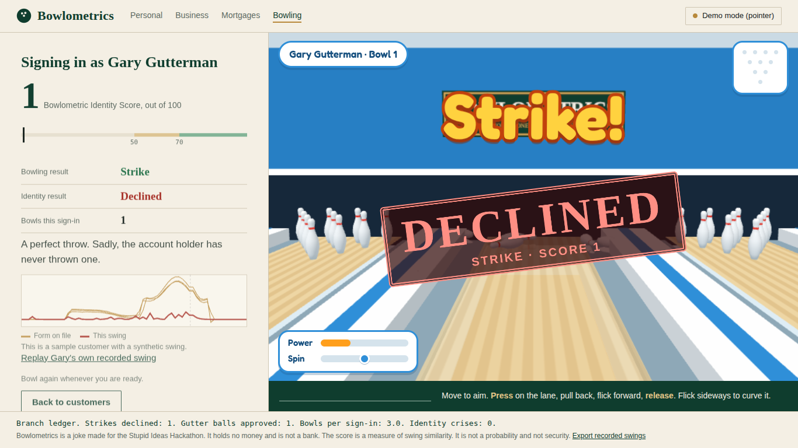

# Bowlometrics

A bank where your password is how you bowl. 🎳

You open a fake bank account by bowling with a Wii remote. To get back in, you bowl again and the bank compares your swing with the one on file. The pins do not matter. A strike can be declined and a gutter ball can be approved.

Made for the Stupid Ideas Hackathon (Ottawa F26). No real money or banking is involved.

## Features

- **Bowling sign-in**: bowl 3 times to open an account, bowl once to sign in.
- **Bowlometric Identity Score**: a number from 0 to 100 for how close your swing is to your swings on file. 70 and up gets in. 50 to 69 means bowl again.
- **Real Wii remote**: accelerometer, buttons and sensor bar aiming, read on Ubuntu through a small local bridge. A MotionPlus is used when attached.
- **Demo mode**: works on the public site with no hardware. Your pointer is the remote, and two sample customers with made-up swings are there to break into.
- **Branch ledger**: counts strikes that were declined and gutter balls that were approved.
- **Evaluation tool**: measures how well the matcher tells recorded people apart.

## Requirements

- [Node.js](https://nodejs.org/) 20 or newer.
- For the Wii remote: Ubuntu 24.04 with Bluetooth, a Wii remote and a USB sensor bar.

## Install & Run

On the Ubuntu demo laptop:

1. Execute `git clone https://github.com/thomasnol/proof-of-human.git`
2. Execute `cd proof-of-human`
3. Run `./scripts/setup-ubuntu.sh`
4. Run `./scripts/pair-wiimote.sh` and press the red SYNC button under the remote's battery cover.
5. Run `./scripts/check-controller.sh` and press buttons, wave the remote and point it at the sensor bar.
6. Run `./scripts/start.sh`
7. Open http://localhost:5173/?mode=wii

On a Mac, or anywhere without the remote:

1. Run `npm install`
2. Run `npm run dev`
3. Open http://localhost:5173/

More on the remote, calibration and fixes: [`docs/hardware.md`](docs/hardware.md).

## Usage

- **Wii remote**: point at the lane to aim, or use the D-pad. Hold B, swing, release B. A remote tilted to one side at the release sends the ball that way, and a wrist twist during the swing makes it curve. The A button presses the main button on screen. Wear the wrist strap.
- **Demo mode**: move the pointer to aim. Press on the lane, pull back, flick forward, release.
- **Switch modes**: click the button at the top right. The app never switches to demo mode by itself when the remote drops.
- **Sample customers**: sign in as Gary Gutterman, get declined, then click "Replay Gary's own recorded swing". His swing is made by a formula and always lands in the gutter.

## How the swing check works

1. The app records the swing from 250 ms before the press to 400 ms after the release.
2. It turns the recording into a signature: 64 points per axis, with the release always at the same point. It adds timing features such as length, when the peak comes and how the motion splits across axes.
3. Two signatures are compared with dynamic time warping and the feature differences. The result is one distance.
4. Your accept distance comes from how much your own enrollment throws differ from each other.
5. A swing that fits two customers is flagged as an identity crisis, and the bank asks again.

Pin count, ball speed and aim are worked out separately in `web/src/game/throw.js` and never reach the matcher.

The score is a similarity measure. It is not a probability, and this is not security.

## Test

1. Run `npm test` for the 38 unit tests. The matcher tests use swings made by a formula.
2. Run `npm run evaluate -- --synthetic` to check the evaluation tool on made-up swings.

To measure real people:

1. Have each person open an account and sign in a few times.
2. Click "Export recorded swings" at the bottom of the page.
3. Move the file into `recordings/`.
4. Run `npm run evaluate`

It reports genuine accepts, false rejects, false accepts and retries, with sample counts. Tune `MATCH_CONFIG` in `web/src/motion/matcher.js` from there.

## Analytics

Amplitude is optional. Put your project API key in `.env` as `VITE_AMPLITUDE_API_KEY` and restart. With no key, nothing is loaded or sent.

Events carry the score, the verdict and the pin count. They never carry names, account numbers or swing recordings.

## Deploy

1. Run `npx wrangler login` once.
2. Run `npm run deploy`

This builds the site and publishes `dist/` to Cloudflare Pages as the `bowlometrics` project. The public site runs in demo mode. The Wii remote only works on the laptop that runs the bridge.

## Technologies

- [Three.js](https://threejs.org/): draws the lane, the ball and the pins.
- [Vite](https://vite.dev/): dev server and production build.
- [ws](https://github.com/websockets/ws): the local WebSocket between the bridge and the browser.
- [hid-wiimote](https://docs.kernel.org/hid/index.html): the Linux kernel driver the bridge reads the remote through.
- [Amplitude](https://amplitude.com/): optional analytics for the stupid metric.
- [Cloudflare Pages](https://pages.cloudflare.com/): hosts the public demo.

The pin physics and the swing matcher are plain JavaScript with no library.

## What was tested

- The full flow in demo mode, driven in a headless Chromium, at laptop and phone sizes. That covers a practice throw, enrollment, a gutter ball that signs in, a strike that is declined and the sample customer replay.
- The production build.
- On the real Wii remote, on Ubuntu 24.04: pairing, button presses, the calibrated accelerometer stream and the sensor bar's two infrared points reaching the bridge.
- Matcher accuracy on real people has not been measured. Use the evaluation tool for that.

## Team

- Name (`@handle`): what you did
- Name (`@handle`): what you did
- Name (`@handle`): what you did

Submission text, the 60 second script and the backup plan are in [`docs/submission.md`](docs/submission.md). The original brief is in [`docs/brief.md`](docs/brief.md).
